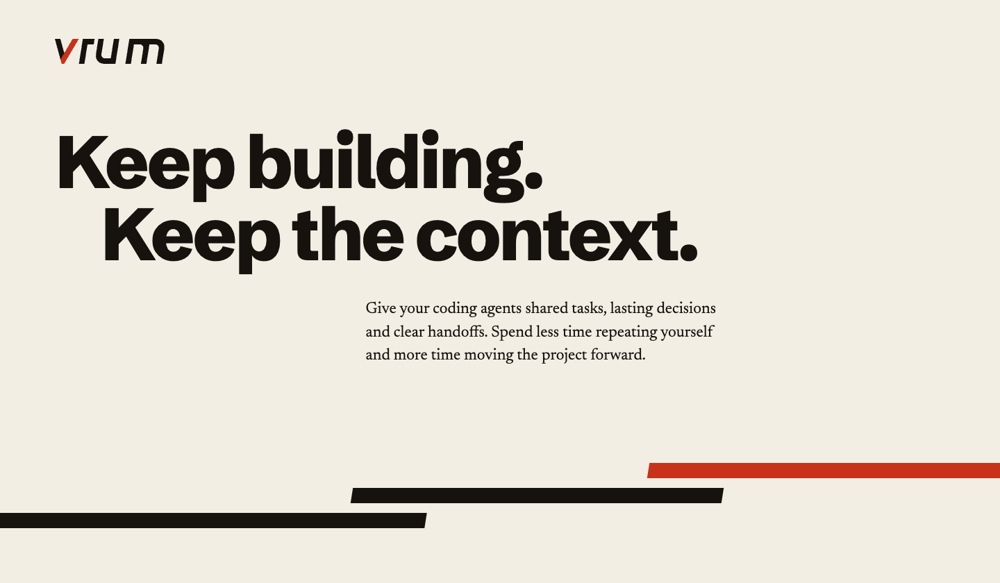

# Vrum

<p align="center">
  
</p>

**Keep building. Keep the context.**

Give your coding agents shared tasks, lasting decisions and clear handoffs. Spend less time
repeating yourself and more time moving the project forward.

Vrum is a project graph that you run yourself, for AI coding agents and the people who work
with them. It keeps what a project is made of: epics that hold stories that hold tasks, the rules
(requirements) each story must meet, the decisions people made and why, and what the team has
learned. Agents use it over MCP, so that every agent, in every session, starts from what is already
known instead of from nothing. People see all of it, and steer it, on a board in the browser. It
is built to be effective and efficient for agents and friendly to people: every refusal says what
is wrong and what to do next, and every answer is small enough to read.

It is a prototype, built one milestone at a time (see `PROGRESS.md`). You register an account on the
board, make private projects there, and give each agent a key for one project. You use a project
through an agent or a script, and through the board (home, Kanban, graph, roadmap, table, outline,
rules, memory, search, overlaps, activity, tools, agent access and status).

## Quick start

You need Docker with Compose. Nothing else is needed to run it.

```
git clone https://github.com/marie-schmidt/vrum.git
cd vrum
./scripts/init-env.sh                  # writes .env with a random database password
docker compose up -d --build --wait    # builds the image and starts the database and the server
```

When that finishes, the server is healthy:

```
curl http://127.0.0.1:8000/health      # {"status":"ok"}
```

The board is at `http://127.0.0.1:8000/board` and the MCP endpoint is
`http://127.0.0.1:8000/mcp` (change the port with `VRUM_PORT` in `.env`). Open the board, **create an
account** with an email address and a password, **create a project**, and it opens. Nothing needs
to be typed in a terminal and no file needs to be read: there is no token to find. To let an agent
in, open the project's **Agent access** page and make it a key (see "Accounts, projects and agent
keys" and "Connect an agent").

- `docker compose down` stops it. Your data stays in a Docker volume and is there when you start
  again.
- `docker compose down --volumes` stops it and **deletes the data**, accounts included.
- `docker compose logs app` shows what the server did, as one JSON line per event. The logs never
  contain passwords, sessions, keys or anything you wrote.

To see for yourself that everything works, from a fresh clone, run `./acceptance.sh` (see
"Checks" below).

## Accounts, projects and agent keys

- **An account** is an email address and a password that Vrum keeps itself: the password only as a
  salted, slow hash (scrypt), never in plain text. Nothing is verified by email, and a forgotten
  password cannot be recovered yet (see `BLOCKED.md`: both wait for an answer from the owner, since
  Vrum has no way to send email). Several accounts may share one install.
- **Signing in** gives the browser a session: a cookie the page's scripts cannot read, that expires
  after 12 hours and ends the moment you sign out. Every change from the board also carries a
  secret that only the board's own page knows and is checked against where it came from, so another
  website cannot make your browser change anything. Failed sign-ins are slowed down: five wrong
  passwords for one address stop that address for ten minutes.
- **A project** is a private workspace: its own epics, stories and tasks, rules, decisions,
  principles, facts, beliefs, claims, history and search. A person sees only the projects they
  made, may make as many as they like, and switches between them from the top bar. Each project
  numbers its own items from 1, so node 12 in one project is not node 12 in another. Nothing is
  shared between projects, and a project can only be reached by its owner and by the agents the
  owner gave a key to. The database itself enforces this (every row belongs to one project and
  cannot refer to a row of another), not only the server.
- **An agent key** lets an agent use one project and no other. On the project's **Agent access**
  page you make a key (a label, such as the name of the agent), copy it once (only a hash of it is
  kept, so it cannot be shown again), and revoke it when it is not wanted. Revoking works on the
  agent's next request, even on a connection that is already open. An agent's name is only what its
  changes are recorded with: it proves nothing and opens nothing.
- **Admins and backups** stay outside accounts: `./scripts/backup.sh` and `./scripts/restore.sh`
  work on the whole database, which holds everything of everyone, so keep them and `.env` where only
  you can read them.
- The server answers only to requests addressed to `localhost`, and compose publishes it on
  `127.0.0.1` only. That is right for one machine. Passwords and keys travel as plain text over
  HTTP: to use it from another machine, put it behind something that adds TLS (the session cookie
  is then marked Secure), and read `DECISIONS.md` (the M6 and M15 sections) first.

## Connect an agent

Any MCP client that speaks streamable HTTP can connect. It needs the address and the **agent key**
of a project: open the project's board, choose **Agent access**, make a key and copy it. A key
reaches that project and no other.

**Claude Code** (it keeps the key in its own settings, so do this where only you can read them):

```
export VRUM_AGENT_KEY=<the key from the Agent access page>
claude mcp add --transport http vrum http://127.0.0.1:8000/mcp --header "Authorization: Bearer $VRUM_AGENT_KEY"
```

**A project file** that any of the clients below can read, as `.mcp.json` at the root of the
project. It holds no key: each client reads `VRUM_AGENT_KEY` from the environment.

```json
{
  "mcpServers": {
    "vrum": {
      "type": "http",
      "url": "http://127.0.0.1:8000/mcp",
      "headers": { "Authorization": "Bearer ${VRUM_AGENT_KEY}" }
    }
  }
}
```

**GitHub Copilot** (the CLI and VS Code) reads the same `mcpServers` shape from
`~/.copilot/mcp-config.json` (for all your projects) or from `.mcp.json` in the workspace, with an
added list of the tools to allow:

```json
{
  "mcpServers": {
    "vrum": {
      "type": "http",
      "url": "http://127.0.0.1:8000/mcp",
      "headers": { "Authorization": "Bearer ${VRUM_AGENT_KEY}" },
      "tools": ["*"]
    }
  }
}
```

**From Python**, with the official MCP SDK (this is what the scripts in `scripts/` and the checks
use; see `scripts/vrum_client.py`):

```python
import asyncio, os
from mcp import Client
from mcp.client.streamable_http import streamable_http_client
from mcp.shared._httpx_utils import create_mcp_http_client


async def main() -> None:
    headers = {"Authorization": f"Bearer {os.environ['VRUM_AGENT_KEY']}"}
    async with (
        create_mcp_http_client(headers=headers) as http,
        Client(streamable_http_client("http://127.0.0.1:8000/mcp", http_client=http)) as client,
    ):
        print(await client.call_tool("server_status", {}))


asyncio.run(main())
```

The Python example is run against the real server by `./acceptance.sh`, so it works. The other
three follow each client's own documentation for remote HTTP servers (Claude Code: "Connect Claude
Code to tools via MCP"; Copilot and VS Code: "MCP configuration reference"); they were not run
here. If a client does not fill in `${VRUM_AGENT_KEY}` for you, put the key in that client's own
user-level settings rather than in a file you commit. If a client says it cannot connect, the
server's answer says why: a missing, wrong or revoked key is refused in plain words.

## The agent guide

This is the text the server hands to every agent when it connects (its MCP instructions). It is
repeated here word for word, and a check fails if the two ever differ.

<!-- agent-guide:start -->
Vrum is a project graph. Epics hold stories, stories hold tasks, and rules, decisions, facts and beliefs are linked to them. A decision is what a named person decided and is authoritative. A belief is only a suggestion. Every write needs an actor: your own name.

The working loop:
1. `next_work` takes the most urgent free story or task and returns it with its rules, decisions, principles, facts, earlier handoff notes and similar items, all in one call. Keep the claim with `renew_claim` while you work.
2. Before you decide something that matters, `recall` what is known about the item. If you do not know where to look, use `search`.
3. Record what is decided as it happens with `record_decision` (name the person who decided in decided_by), and what you learn with `retain_fact`.
4. End with `finish_work`: say whether it is done, blocked, dropped or released, and leave a handoff note for whoever comes next. A blank note is refused.

Also: `create_plan` creates a whole plan at once or nothing, `update_nodes` changes many nodes, `changes_since` shows only what is new since an event, and `ready_work` lists what is free. `list_nodes` takes a filter text as its query argument, such as `kind:task status:ready -claimed OR is:overdue`. [[node:12]] in any text refers to an item (also rule, decision, fact, belief); `find_mentions` lists who refers to one. Lists leave out bodies unless you ask for detail. Refusals say what is wrong and what to do next. Anything holding a well-known secret format is refused in every field and never stored: leave secrets out of what you write. If the server has a language model, `extract_facts`, `consolidate_memory`, `find_contradictions` and `reflect` use it on the memory; what they return is proposed or generated, and is not a record until you record it.
<!-- agent-guide:end -->

Every tool describes itself: its description says what it does, what it needs and what it refuses,
and the client lists them all.

## The board

The board is for people. It is at `http://127.0.0.1:8000/board`, served by the same container and
on the same port as the MCP endpoint, and it shows and changes the very same graph: whatever an
agent does appears on it within a few seconds with no reload, and whatever you do on it is what an
agent reads next. It keeps no data of its own, and loads nothing from the internet.

**Signing in and your projects.** `/board` asks you to sign in or to create an account (a name, an
email address and a password of 10 characters or more). Every refusal says what is wrong, and a
wrong password or an address with no account gets the same answer. Once in, you see your own
projects, with an empty state and a box to create the first one when you have none; creating one
opens its board at `/board/p/<number>`. The top bar of every page says which project you are in
and switches to another (choosing one loads that project's board afresh, so nothing of the first
can appear in the second); **Sign out** ends the session on the server. A project's address copied
to another account opens nothing: it is refused in the same words as a project that does not
exist. Changes are recorded with your name, taken from your account when you sign in and
changeable with "You are …: change", next to the agents' names.

**Agent access.** The keys of the project: make one with a label, copy it (it is shown once), see
when each was made and last used, and revoke the ones that are not wanted. It also shows the
endpoint and how to send a key. See "Accounts, projects and agent keys".

**Board.** One column for each status and one lane for each epic. A card is a story or a task and
shows who holds it and until when, what it is waiting for, its due date (and whether it is overdue
or planned to start before something it needs is due), and its progress. Drag a card to another
column of its own epic to change its status, or use its **Move** menu from the keyboard. *Ready* is
worked out from the links, so nothing can be dropped there. Open a card to read and change its
title, details, priority, dates and parent, to add or remove links, and to see its rules, the
decisions in force, its facts and beliefs (a belief is shown as a suggestion, and every fact and
belief with where it came from), what the index thinks it may duplicate, and its history. **New
item** makes an epic, a story or a task, and **Coverage** lists the rules that are in no story and
the stories that have no rule.

**Graph.** The same work drawn as dots and lines, with a different shape for each kind and a
different line for each kind of link, so colour is never the only clue. It opens on one epic.
**Everything** draws every item, until there are more than a thousand dots, and then draws each epic
as one dot and says so. **Around the chosen item** draws only what is one to three steps away.
Rules, decisions, facts, beliefs and suggested overlaps are drawn once you switch them on. Drag a
dot to pin it, zoom and pan, colour by kind, status or epic, and filter by kind, status and kind of
line. Beside the drawing, a list of the chosen item's neighbours and a list of every item in view
do everything a click on the drawing does, from the keyboard.

**Rules.** Every rule, grouped by the story that owns it, with the rules that are in no story
first (the newest on top) and the coverage report below: the rules in no story, and the stories
with no rule, with dropped rules and stories left out. Write a rule (**New rule**), change its
title, details or status (**Edit**), and put it in a story: drag it onto a story, or choose **Put in
a story…**, where **Place** puts a rule that is in no story into one and **Move** takes a rule from
its story to another in one step. A rule is in at most one story, so placing a rule that is already
in one is refused, in the server's words. Dropped rules are hidden until you ask for them.

**Memory.** What the project remembers, in four lists on one page: principles (pinned at the top),
decisions, facts and beliefs, newest first. Filter by kind, status, origin, who recorded or decided
it, the day, and the item it concerns. Every entry says where it came from and who: a decision its
decider and reason, a fact its source, a belief the evidence it rests on and whether a person has
confirmed it. A belief is marked as a suggestion, never a decision; anything a language model
proposed or drew up says so; a stale belief (one whose evidence is no longer in force) is shown
apart with which evidence changed; and a replaced item shows the chain to what replaced it.
From the page a person can record a decision, a fact or a belief (picking its evidence from a
list), say what each concerns, replace one with a newer one or retract it (nothing is edited: the
form starts from the old words and records a new item, and a retraction offers to retract or
replace the beliefs that went stale), confirm a belief, and make a belief a decision under their
own name and reason. Choose several facts or beliefs to replace or retract them together; replacing
a belief a person confirmed asks who changed their mind and what they said. When the server has a
language model, writing a fact or a belief offers to check it against every belief: it shows how
far the check has got, then each proposal with the words that clash, with buttons to replace the
belief or retract it. The **recall preview** at the top shows what an agent would be told for an
item or a rule: the very answer of the `recall` tool, in its sections and with its reasons.

**Search.** One box over the `search` tool. Each result says how it matched (exact words, meaning
or both), why, shows a snippet with the matched words marked, and its parent and status as the
graph holds them now. Choose *Exact words only* or *Meaning only* to see one kind of match. The
counts by kind (epic, story, task, rule, decision, principle, fact, belief), by status and by epic
filter the results and keep the server's order. The page says how many items are waiting to be
indexed: results by meaning may lag behind them, results by exact words never do. With the
embedding service stopped, search by words still works, and searching by meaning says why it
cannot. Under the results, **Ask** puts a question to a language model (if the server has one,
see below): the answer is labelled *Generated, not a record*, shows the items it relied on as
links, and is stored nowhere. You can record its conclusion as a belief under your own name,
resting on those facts and decisions, or leave it. Without a model the box says so.

**Overlaps.** Pairs of stories (or epics, or rules) in different epics that look like the same
thing, most alike first, with their scores, side by side with their details. Change how alike
they must be (the server's setting is the start), or name epics to look at only pairs that have
something in them. **Mark as duplicates** and **Mark as relates to** make that link in one click,
with your name, and nothing is ever linked unless you click. Rules are compared too, and cannot
be linked.

**Markdown and references.** Details, rules, reasons, decision texts, facts and beliefs are shown
as Markdown by the board's own small renderer: headings, paragraphs, lists, emphasis, code, quotes
and web addresses, which open in a new tab. Raw HTML is never rendered and nothing is loaded from
elsewhere, so a script or image tag is shown as the text it is. Write `[[node:12]]`, `[[rule:3]]`,
`[[decision:7]]`, `[[fact:5]]` or `[[belief:2]]` in any text to refer to an item: it is shown as a
link with the item's current title (and follows a rename), or plainly as missing when nothing has
that id. Typing `[[` in an editor offers a pick-list. A reference is only text: it makes no link
and changes no readiness and no order. Every item shows **Mentioned in**, the items whose text
refers to it (the `find_mentions` tool works this out when asked and stores nothing), and the
graph has a **Mentions** layer that draws them. Titles are not read for references.

**Jump to.** Press Ctrl+K (⌘K on a Mac), or use the button in the top bar, on any page: type a
word of an item's title, its id (`12`, `#12`, `rule 3`, `decision 7`) or the name of a page, and
Enter goes there.

**Home.** The page you land on. It says what needs a person's attention, as numbers you can click:
ready work nobody holds, blocked and overdue items, claims that ran out with no handoff note,
rules in no story, stories with no rule, decisions made in the last 7 days, stale beliefs, beliefs
waiting for a person to confirm them, overlap candidates nobody has marked, and items waiting to
be indexed. Each number is the same answer the tools give, and following it lands on exactly those
items (the Table with that filter, or the Rules, Memory, Overlaps or Status page). Below them each
epic shows how many stories and tasks it has in each status, as links.

**Activity.** What happened, newest first, in plain words ("Ada moved rule 7 from story #3 to story
#5"), with a handoff note shown in full. New changes appear within seconds with no reload. Filter by
who, by kind of change, by item and by day (UTC); the filter is in the address. On the right,
**Who is working on what** shows every claim in force with a countdown and every claim that ran out,
and each agent's state (working, lapsed, finished). You can claim an item under your typed name
(by its number, or from the work that is free to take), renew a claim, or release it with a note:
the same operations an agent calls. A claim that ends moves to *lapsed* by itself.

**Tools.** Every tool the server has, read from the server itself so the list can never be out of
date: its description, its fields, whether it changes anything, and where on the board it can be
done, or why it is for agents only. Any tool that only reads has **Try it**, which fills in a form
from the tool's fields and shows what the server answers. A tool that changes something has no
Try it, and the server refuses one even if it is asked. It also shows the endpoint, and how to send
an agent key with an example connection.

**Status.** The version of Vrum, PostgreSQL and pgvector, how many of each kind of item there are,
the state of the search index (how many wait to be indexed, which embedding service and model it
uses, whether the service answers, the size of the vectors and the last reindex since the server
started), and whether a language model is set up. It is what `server_status` says, for this
project. **Download export** saves the whole graph of this project as one JSON file, identical to
the one `export_graph` gives, with nothing of any account in it. Backup, restore and import stay on
the command line (see below), and the page says so. No password, session or key and not the
database password is ever shown anywhere.

**Table.** One row for each epic, story or task, with its kind, title, parent, status, priority,
who holds it, what it waits on, progress, dates and last change. Click a heading to sort (again to
reverse, a third time to clear), group by epic, story, status, priority or who holds it, and
filter with the filter language below. Change a title, status, priority or date in the row itself.
To change several rows at once, tick them, choose a priority and a status, and apply: each row is
its own change at the version you saw it, and the result says which rows changed and which were
refused, and why (for example because an agent changed that row since).

**Outline.** The work as a tree you can fold: epics, their stories, their tasks, with the rules
under each story and how many tasks are done on every branch. Drag a story or a task onto its new
parent, or press `m` on it to choose one from a menu. The arrow keys walk the tree, Enter opens an
item, and a refused move says why.

**Roadmap.** The work on a timeline, each item a bar from its start date to its target date, with
a line for today and zoom by month, quarter or year. Group by epic, status, priority or who holds
it, and filter with the filter language. Drag a bar to move both dates, or one end to move that
date; with a bar focused, the arrow keys move it a day (Shift for a week, Alt for the start only,
Ctrl for the target only), and Space picks several bars to move together. A pale dashed bar is an
epic or story with no dates of its own, drawn over the span of what is under it. An arrow runs from
what must come first to the item that waits for it; an item planned to start before something it
needs first is due is marked "Schedule conflict" (a warning, nothing is blocked), and an overdue
item says so in words. Items with no dates wait in a tray above: drag one onto the timeline to give
it a week starting where you drop it, or type its dates there. The roadmap has no sprints.

**The filter language.** One way to say which items you mean, for the Table's and the Roadmap's
filter box and for the agents' `list_nodes` tool (as `query`), with the same answer for both.

- Words find items whose title or details contain them, whatever the case: `login "reset password"`.
- `field:value` narrows by a field, and commas mean "any of these": `status:ready,in_progress`.
  The fields are `kind`, `status`, `priority`, `claimed`, `parent`, `epic`, `story`, `id`,
  `start`, `target`, `is` and `no`.
- A leading `-` leaves things out: `-status:done`, `-claimed` (not held by anyone).
- `claimed` and `waiting` alone mean held by someone and waiting on something; `no:field` means
  empty (`no:start`, `no:target`, `no:claimed`, `no:parent`, `no:body`, `no:waiting`).
- `start:` and `target:` take a day, a range (`2026-11-01..2026-12-31`, either end may be left
  open) or `none`; `is:` finds `overdue`, `conflict` (planned to start too early), `waiting`,
  `claimed` and `lapsed` (a claim that ran out).
- `OR` between groups: `kind:task status:ready -claimed priority:high OR kind:story`. Terms next
  to each other must all hold; `OR` (in capitals) starts a new group.

A query that cannot be read is refused with a plain message saying what was not understood, and
nothing is listed. Every page has its own address, with the filter, sort, grouping and zoom after
the `#`, so you can share a view by copying the link: the server keeps no saved views.

**It is the same graph.** A change on the board is the same operation an agent calls, with the same
checks. If you drop a card where it cannot go, or edit something an agent has changed since you
read it, the board says what the server says, in the same words, and keeps what you typed. Every
page has its own address, and what you chose lives in it after the `#` (never a session or a key), so you
can share a view by copying the link. How often the board asks for news is
`VRUM_BOARD_POLL_SECONDS` (5 by default).

## What is in it

- **Work:** epics, stories and tasks, in an exact hierarchy, with priority, status, a start and a
  target date, and links between them (`needs_first`, `supersedes`, `duplicates`, `relates_to`).
  What is ready to start is worked out, never typed in. Work is claimed with a lease, so two agents
  never take the same task, and a handoff note says what the next one must know.
- **Rules:** each requirement sits in exactly one story, and a report lists the ones with no story
  and the stories with no rules.
- **Decisions and principles:** what a named person decided and why. They are never edited: a
  change of mind is a new decision that replaces the old one, which stays as a record.
- **Facts and beliefs:** a fact is something known, with where it came from. A belief is a
  conclusion that rests on facts and decisions, and is marked stale when one of them stops being
  true. A belief is only a suggestion until a person confirms it, and never counts as a decision.
- **Search:** by exact words, by meaning, or both, and each result says how it matched. It also
  finds similar items and stories that overlap across epics. Any text can refer to an item with
  `[[node:12]]`, and `find_mentions` says what refers to what.
- **History:** every change is kept, with who made it and what it was before. `changes_since`
  gives an agent only what is new.

## Optional: finding by meaning, and a language model

Searching by exact words needs nothing. Searching by meaning, similar items and overlaps need an
embedding service, and four tools need a language model: `extract_facts`, `consolidate_memory`,
`find_contradictions` and `reflect`. Without them everything else works, and those tools say so.
Both are any OpenAI-compatible service, set in `.env` (see `.env.example` for every setting).

- To run an embedding model on this machine, add `EMBEDDING_BASE_URL=http://ollama:11434/v1` and
  `EMBEDDING_MODEL=all-minilm`, and start with
  `docker compose --profile local-embeddings up -d --build --wait` (the first start downloads about
  50 MB).
- For a language model, set `LLM_BASE_URL` and `LLM_MODEL`. Nothing is sent anywhere unless you set
  a URL, and text that holds a well-known secret format (an access token, a private key) is never
  sent.

What a model proposes is always checked against the text or the evidence it was given and labelled
as proposed or generated. It is never a record until a person or an agent records it.

## Backup, restore and moving data

- **Backup:** `./scripts/backup.sh` writes the whole database to one file (by default in
  `backups/`, which is not committed), while the server keeps running. It holds everything of every
  account and project, password hashes and keys' hashes included, so it is not an ordinary
  account's to take: it is for whoever runs the server. The file is readable only by you and is not
  encrypted, so keep it where only you can read it.
- **Restore:** `./scripts/restore.sh <file>` puts it back, accounts and projects with it. Into a
  fresh database (after `docker compose down --volumes`) it just restores. Into a database that
  holds data it refuses, unless you add `--replace`. It restores into a new database first and
  swaps it in only when that worked, so a bad backup never costs what is there.
- **Export and import of one project:** with the agent key of the project in `VRUM_AGENT_KEY`,
  `uv run python scripts/export_graph.py http://127.0.0.1:8000/mcp graph.json` writes the whole
  graph of that project as one JSON file that you can read and keep, and `scripts/import_graph.py`
  loads such a file into an **empty project** (make one on the board, and a key for it), keeping
  every id, date, origin and the history. It is all or nothing, and the file can be as big as one
  request may be (4 MiB unless you raise `VRUM_MAX_REQUEST_BYTES`). Accounts, sessions and keys are
  never in the file.
- **Markdown copy:** `uv run python scripts/export_markdown.py http://127.0.0.1:8000/mcp notes`
  writes one file for every epic, story, task, rule, decision, fact and belief of the project, with
  its fields at the top and everything it is connected to as `[[references]]`, to read in Obsidian
  or keep in git. It is read-only and is made again from the graph each time.

These scripts need `uv` and `VRUM_AGENT_KEY` in the environment (`export VRUM_AGENT_KEY=<the key>`).

## Settings

Everything is set in `.env`, which `docker compose` reads. `.env.example` lists every setting with
what it does. The ones you are likely to want:

| Setting | What it does |
| --- | --- |
| `VRUM_DB_PASSWORD` | The database password. Required. `./scripts/init-env.sh` makes one. |
| `VRUM_PORT` | The port on this machine. 8000 by default. |
| `VRUM_BIND_ADDRESS` | The address the port is published on. `127.0.0.1` by default: this machine only. |
| `VRUM_MAX_REQUEST_BYTES` | The most one request may hold. 4 MiB by default. |
| `VRUM_BOARD_POLL_SECONDS` | How often the board asks the server what changed. 5 by default. |
| `EMBEDDING_BASE_URL`, `EMBEDDING_MODEL` | An embedding service, for search by meaning. |
| `LLM_BASE_URL`, `LLM_MODEL` | A language model, for the four tools that need one. |

## Checks

You need Docker with Compose, `uv` and `openssl`. Neither check touches your own stack or your
`.env`: each builds its own throwaway stack with a random database password and removes it afterwards.

- `./check.sh` is for developers, before a commit: lint, strict types, unit tests, and hundreds of
  integration tests against real containers, with a real MCP client and a real headless browser
  for the board. The browser is Playwright's Chromium, a development tool that is never in the
  image; `uv` downloads it the first time (about 100 MB).
- `./acceptance.sh` is the shorter story to read and trust. From a clean clone it starts Vrum,
  and walks one scenario through a real MCP client and a headless browser: it registers an account,
  creates a project and an agent key, and is turned away without one, plans, works with ten agents at once, decides, remembers, finds, asks a
  model for help, is careful with secrets, shows the board to a person (what agents do appears on
  it, what a person does is in the graph, refusals read the same), shows the table, outline and
  roadmap (the filter language, changing several rows, dragging bars, an address that reproduces a
  view), writes rules and memory on the board (placing and dragging a rule, recording and replacing
  decisions and beliefs, stale beliefs, confirming and promoting, a check against every belief and
  the recall preview), finds and connects on the board (search by words and by meaning with the
  embedding service stopped and back, counts, overlaps and what a click on a pair creates,
  Markdown that is only ever text, references and their backlinks, the quick switcher, and Ask),
  runs and sees it all (Home's numbers and where each leads, an agent's work and a person's claim
  appearing in Activity, a claim that runs out, the Tools page against the server's own list, and
  Status and the export compared with the tools), and finally backs up, destroys
  its own database, restores it, and loads an export into a fresh server. Every line it prints is
  one proof that holds. It uses a scripted stand-in for the embedding service and the language
  model, so nothing is downloaded and the answers are the same every run.
  `./acceptance.sh finding model` runs only those chapters.

## Where things are

- `SPEC.md` says what Vrum is, milestone by milestone, with the proof each one has to pass.
- `PROGRESS.md` says how far it has got, with the proof as it was run.
- `DECISIONS.md` lists every choice the specification left open, so that you can overrule any.
- `BLOCKED.md` lists the questions only the owner can answer (email verification, account recovery).
- `AGENTS.md` tells whoever works on the code how to run it and where things are.
- `src/vrum/board/` holds the board: its server side and its page files (plain HTML, CSS and
  JavaScript, with no build step), and the logo and icons in `src/vrum/board/static/brand/`.
- `docs/marketing/` holds the website header and the social sharing image.
