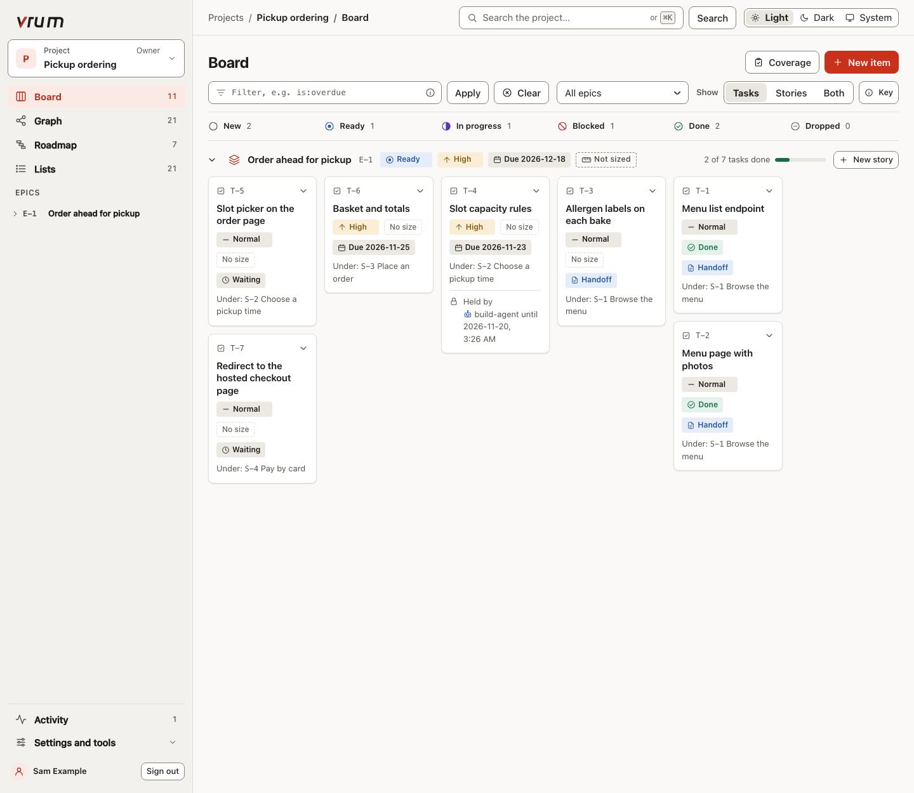
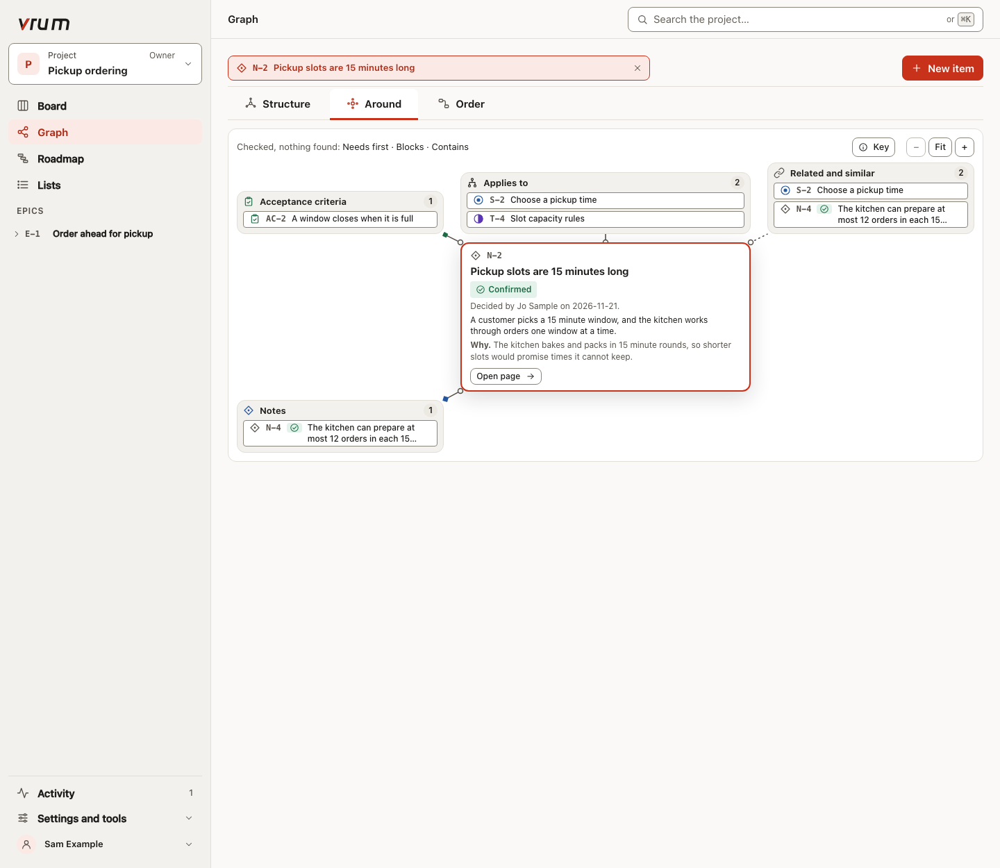

# Vrum

## Overview

Software projects are now worked on by several people and by AI coding agents at the same time.
Each agent session starts with no memory of the last one, so the same two problems come back every
day. Work collides: two agents pick up the same task, or one starts something that depends on a
piece nobody has finished. And context disappears: why a choice was made, what the team learned
from a customer, where the previous session stopped. That knowledge sits in chat logs and in
people's heads.

Vrum is a server that keeps a project's work and its context in one shared place, for people and
agents alike. People use a board in the browser. Agents connect through MCP, the Model Context
Protocol, a standard way for AI tools to call a service. Both work on the same data through the same
operations, so what an agent does shows on the board within seconds, and what a person decides is
what an agent reads next.

What is distinctive:

- **One graph of work and context.** Epics hold stories and stories hold tasks. Requirements,
  decisions and facts are linked to the work they concern, so an agent that takes a task is handed
  those decisions and facts with it.
- **Readiness is worked out, not typed.** A task is ready only when everything it needs first is
  done.
- **Claims with leases.** An agent takes a task for a limited time. Two agents cannot hold the same
  task, and a claim that runs out frees it again.
- **Durable handoffs.** Ending work requires a note, and the next person or agent is shown it.
- **Decisions and facts record who confirmed them.** A decision keeps its reason and who decided it,
  and a fact keeps its source. Each starts unconfirmed and becomes confirmed only when a named
  person says they reviewed it. Replaced and withdrawn records stay, with their reasons.

Vrum stores and coordinates. It does not generate text: the agents connected to it do the reasoning
and record what they find. It is a prototype that runs on one machine.



*Example project with fictional data. The Board shows each story and task by status, what it is
waiting for, and which agent holds it and until when.*

## Getting started

You need Docker with Compose. Nothing else is needed to run Vrum. (`uv` is used only by the checks
and the helper scripts.)

```
git clone https://github.com/marie-schmidt/vrum.git
cd vrum
docker compose up -d --build --wait
```

There is nothing to set up first. The first start makes a random database password and keeps it in
a Docker volume, and the first build downloads images, so it takes a minute or two. When it
finishes, `curl http://127.0.0.1:8000/health` answers `{"status":"ok"}`.

1. Open the board at `http://127.0.0.1:8000/board`. If something else already uses port 8000, start
   Vrum with another one, for example `VRUM_PORT=8090 docker compose up -d --build --wait`, and use
   that port in every address below.
2. Create an account: a name, an email address and a password of at least 10 characters. Vrum keeps
   them itself and sends no email.
3. Create a project. It opens on the Board.
4. Choose **New item** to make an epic, then another to make a story in it, then a task in the
   story. A task with nothing to wait for is Ready.
5. To let an agent in, open **Settings & tools**, then **Agent access**, in the sidebar. Create a
   key and copy it. It is shown once, and it reaches this project and no other. Then give it to the
   agent. For Claude Code:

   ```
   export VRUM_AGENT_KEY=<the key you copied>
   claude mcp add --transport http vrum http://127.0.0.1:8000/mcp --header "Authorization: Bearer $VRUM_AGENT_KEY"
   ```

6. Ask the agent to take the next piece of work with `next_work`. The task shows as held on the
   Board, and the claim and the handoff note the agent leaves when it finishes appear in the
   **Activity** drawer.

For other clients, and for the guide the server gives every agent, see
[Connecting an agent](docs/agents.md).

`docker compose down` stops Vrum and keeps your data. `docker compose down --volumes` stops it and
deletes the data, accounts included.

Once a project has some history, the Graph shows how its work connects to the facts and decisions
behind it. Choosing a record opens its details.



*Example project with fictional data. The Graph around one decision: the work it applies to, the
requirement it serves and the fact behind it. The decision was confirmed by a named person, and the
detail panel on the right shows who and when.*

## How it is built

A Python 3.12 server, using the official MCP SDK, in front of PostgreSQL 17 with pgvector. Two
containers.

- **The database enforces the rules.** The epic, story and task hierarchy, one claim at a time on an
  item, no circle of items waiting on each other, decisions and facts that are never edited and an
  append-only history are constraints and triggers in one schema file (`src/vrum/schema.sql`). No
  code path can write around them. What is ready is a view computed from the links.
- **Projects are isolated by row-level security.** Every row carries its project in its keys. Each
  request runs as a database role that can see only that project's rows, so isolation does not
  depend on the application remembering to filter.
- **The MCP server and the board share their operations.** A board action calls the same tool an
  agent would, with the same checks and the same refusals. The board keeps no data of its own.
- **A front end with no build step.** Plain HTML, CSS and JavaScript modules, no libraries, a strict
  content security policy, and text is only ever put on a page as text.
- **Embeddings are optional and separate.** Search by meaning and possible duplicates use an
  embedding service you choose. Search by exact words needs nothing.
- **Nothing is generated on the server.** Vrum never calls a language model. Confirmation is a named
  person's review, recorded with the time.
- **Secrets are kept out.** Text that holds a well-known secret format is refused on every write,
  and logs are scrubbed.

## Checks

Both commands need Docker with Compose and `uv`, and the second also needs `openssl`. Each builds
its own throwaway stack with a random database password and removes it afterwards. They never touch
your own stack or your `.env`.

- `./check.sh` runs lint, strict type checking, unit tests and the integration tests, which use real
  containers, a real MCP client and a headless browser for the board. The first run downloads that
  browser (Playwright's Chromium, about 100 MB), which is a development tool and never in the image.
- `./acceptance.sh` is a shorter scenario to read. It walks through one project's life with a real
  MCP client and a browser, and prints one line for each proof.

## More documentation

- [Connecting an agent](docs/agents.md): keys, client configuration, and the agent guide.
- [The board](docs/board.md): what each view does, the filter language and the addresses.
- [Configuration](docs/configuration.md): every setting, and search by meaning with an embedding
  service.
- [Backup, restore and export](docs/backup-and-export.md): copies of the whole database and of one
  project.
- `SPEC.md` says what Vrum is, `PROGRESS.md` how far it has got, `DECISIONS.md` which choices were
  left open, and `AGENTS.md` how to work on the code.

## Limitations

- It is a prototype, built for one machine. There are no database migrations: a new version may need
  a fresh database, so keep an [export](docs/backup-and-export.md).
- It speaks plain HTTP and only answers requests addressed to `localhost`. Passwords and keys travel
  as plain text. To use it from another machine, put it behind something that adds TLS first.
- There is no email verification and no password recovery. Vrum has no way to send email. See
  `BLOCKED.md`.
- Search by meaning needs an embedding service that you provide.
