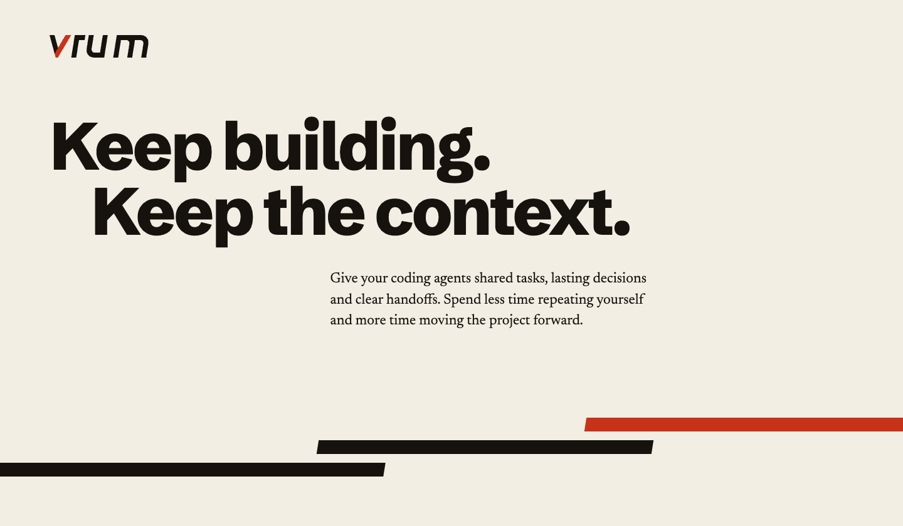

# Vrum

<p align="center">
  
</p>

**Keep building. Keep the context.**

Give your coding agents shared tasks, lasting decisions and clear handoffs. Spend less time
repeating yourself and more time moving the project forward.

Vrum is a project graph that you run yourself, for AI coding agents and the people who work
with them. It keeps what a project is made of: epics that hold stories that hold tasks, the rules
(requirements) each story must meet, the decisions people made and why, and what the team has
learned. Agents use it over MCP, so that every agent, in every session, starts from what is already
known instead of from nothing. People see all of it, and steer it, on a board in the browser. It
is built to be effective and efficient for agents and friendly to people: every refusal says what
is wrong and what to do next, and every answer is small enough to read.

It is a prototype, built one milestone at a time (see `PROGRESS.md`). You use it through an agent
or a script, and through the board (a Kanban board and a graph so far, with more pages to come).

## Quick start

You need Docker with Compose. Nothing else is needed to run it.

```
git clone https://github.com/marie-schmidt/vrum.git
cd vrum
./scripts/init-env.sh                  # writes .env with a random database password and a random token
docker compose up -d --build --wait    # builds the image and starts the database and the server
```

When that finishes, the server is healthy:

```
curl http://127.0.0.1:8000/health      # {"status":"ok"}
```

The MCP endpoint is `http://127.0.0.1:8000/mcp` and the board is at `http://127.0.0.1:8000/board`
(change the port with `VRUM_PORT` in `.env`).

- `docker compose down` stops it. Your data stays in a Docker volume and is there when you start
  again.
- `docker compose down --volumes` stops it and **deletes the data**.
- `docker compose logs app` shows what the server did, as one JSON line per event. The logs never
  contain the token, passwords, keys or anything you wrote.

To see for yourself that everything works, from a fresh clone, run `./acceptance.sh` (see
"Checks" below).

## The token

Every request to the server has to carry a token, as `Authorization: Bearer <token>`. There is no
default token and no way to turn this off: the server does not start without one. Only
`GET /health` is open.

- `./scripts/init-env.sh` makes a random token (48 characters) and puts it in `.env` as
  `VRUM_TOKEN`. `.env` is not committed. If you already have a `.env` without a token, running the
  script adds one and leaves the rest alone.
- To use your own, set `VRUM_TOKEN` in `.env` to at least 16 visible characters with no spaces. To
  change it, edit `.env` and run `docker compose up -d`.
- Whoever has the token can read and change everything. Keep it as secret as the database
  password.
- The token travels as plain text over HTTP, and the server answers only to requests addressed to
  `localhost`, and compose publishes it on `127.0.0.1` only. That is right for one machine. To use
  it from another machine, put it behind something that adds TLS, and read `DECISIONS.md` (the M6
  section) first.

## Connect an agent

Any MCP client that speaks streamable HTTP can connect. It needs the address and the token.

**Claude Code** (it keeps the token in its own settings, so do this where only you can read them):

```
export VRUM_TOKEN=<the token from .env>
claude mcp add --transport http vrum http://127.0.0.1:8000/mcp --header "Authorization: Bearer $VRUM_TOKEN"
```

**A project file** that any of the clients below can read, as `.mcp.json` at the root of the
project. It holds no token: each client reads `VRUM_TOKEN` from the environment.

```json
{
  "mcpServers": {
    "vrum": {
      "type": "http",
      "url": "http://127.0.0.1:8000/mcp",
      "headers": { "Authorization": "Bearer ${VRUM_TOKEN}" }
    }
  }
}
```

**GitHub Copilot** (the CLI and VS Code) reads the same `mcpServers` shape from
`~/.copilot/mcp-config.json` (for all your projects) or from `.mcp.json` in the workspace, with an
added list of the tools to allow:

```json
{
  "mcpServers": {
    "vrum": {
      "type": "http",
      "url": "http://127.0.0.1:8000/mcp",
      "headers": { "Authorization": "Bearer ${VRUM_TOKEN}" },
      "tools": ["*"]
    }
  }
}
```

**From Python**, with the official MCP SDK (this is what the scripts in `scripts/` and the checks
use; see `scripts/vrum_client.py`):

```python
import asyncio, os
from mcp import Client
from mcp.client.streamable_http import streamable_http_client
from mcp.shared._httpx_utils import create_mcp_http_client


async def main() -> None:
    headers = {"Authorization": f"Bearer {os.environ['VRUM_TOKEN']}"}
    async with (
        create_mcp_http_client(headers=headers) as http,
        Client(streamable_http_client("http://127.0.0.1:8000/mcp", http_client=http)) as client,
    ):
        print(await client.call_tool("server_status", {}))


asyncio.run(main())
```

The Python example is run against the real server by `./acceptance.sh`, so it works. The other
three follow each client's own documentation for remote HTTP servers (Claude Code: "Connect Claude
Code to tools via MCP"; Copilot and VS Code: "MCP configuration reference"); they were not run
here. If a client does not fill in `${VRUM_TOKEN}` for you, put the token in that client's own
user-level settings rather than in a file you commit. If a client says it cannot connect, the
server's answer says why: a missing or wrong token is refused in plain words.

## The agent guide

This is the text the server hands to every agent when it connects (its MCP instructions). It is
repeated here word for word, and a check fails if the two ever differ.

<!-- agent-guide:start -->
Vrum is a project graph. Epics hold stories, stories hold tasks, and rules, decisions, facts and beliefs are linked to them. A decision is what a named person decided and is authoritative. A belief is only a suggestion. Every write needs an actor: your own name.

The working loop:
1. `next_work` takes the most urgent free story or task and returns it with its rules, decisions, principles, facts, earlier handoff notes and similar items, all in one call. Keep the claim with `renew_claim` while you work.
2. Before you decide something that matters, `recall` what is known about the item. If you do not know where to look, use `search`.
3. Record what is decided as it happens with `record_decision` (name the person who decided in decided_by), and what you learn with `retain_fact`.
4. End with `finish_work`: say whether it is done, blocked, dropped or released, and leave a handoff note for whoever comes next. A blank note is refused.

Also: `create_plan` creates a whole plan at once or nothing, `update_nodes` changes many nodes, `changes_since` shows only what is new since an event, and `ready_work` lists what is free. `list_nodes` takes a filter text as its query argument, such as `kind:task status:ready -claimed OR is:overdue`. Lists leave out bodies unless you ask for detail. Refusals say what is wrong and what to do next. Anything holding a well-known secret format (an access token, a private key) is refused in every field and never stored: leave secrets out of what you write. If the server has a language model, `extract_facts`, `consolidate_memory`, `find_contradictions` and `reflect` use it on the memory; what they return is proposed or generated, and is not a record until you record it.
<!-- agent-guide:end -->

Every tool describes itself: its description says what it does, what it needs and what it refuses,
and the client lists them all.

## The board

The board is for people. It is at `http://127.0.0.1:8000/board`, served by the same container and
on the same port as the MCP endpoint, and it shows and changes the very same graph: whatever an
agent does appears on it within a few seconds with no reload, and whatever you do on it is what an
agent reads next. It keeps no data of its own, and loads nothing from the internet.

**Signing in.** Type the token (`VRUM_TOKEN` in your `.env`) once for this browser tab. It is sent
in a header, and is never put in the address or a cookie. Then give it your name: every change you
make is recorded with it, next to the agents' names. A blank name is refused.

**Board.** One column for each status and one lane for each epic. A card is a story or a task and
shows who holds it and until when, what it is waiting for, its due date (and whether it is overdue
or planned to start before something it needs is due), and its progress. Drag a card to another
column of its own epic to change its status, or use its **Move** menu from the keyboard. *Ready* is
worked out from the links, so nothing can be dropped there. Open a card to read and change its
title, details, priority, dates and parent, to add or remove links, and to see its rules, the
decisions in force, its facts and beliefs (a belief is shown as a suggestion, and every fact and
belief with where it came from), what the index thinks it may duplicate, and its history. **New
item** makes an epic, a story or a task, and **Coverage** lists the rules that are in no story and
the stories that have no rule.

**Graph.** The same work drawn as dots and lines, with a different shape for each kind and a
different line for each kind of link, so colour is never the only clue. It opens on one epic.
**Everything** draws every item, until there are more than a thousand dots, and then draws each epic
as one dot and says so. **Around the chosen item** draws only what is one to three steps away.
Rules, decisions, facts, beliefs and suggested overlaps are drawn once you switch them on. Drag a
dot to pin it, zoom and pan, colour by kind, status or epic, and filter by kind, status and kind of
line. Beside the drawing, a list of the chosen item's neighbours and a list of every item in view
do everything a click on the drawing does, from the keyboard.

**What it does not do yet.** Rules, decisions, facts and beliefs are shown but not edited on the
board: an agent still does that. More pages (memory, search and the rest) come in the next
milestones.

**Table.** One row for each epic, story or task, with its kind, title, parent, status, priority,
who holds it, what it waits on, progress, dates and last change. Click a heading to sort (again to
reverse, a third time to clear), group by epic, story, status, priority or who holds it, and
filter with the filter language below. Change a title, status, priority or date in the row itself.
To change several rows at once, tick them, choose a priority and a status, and apply: each row is
its own change at the version you saw it, and the result says which rows changed and which were
refused, and why (for example because an agent changed that row since).

**Outline.** The work as a tree you can fold: epics, their stories, their tasks, with the rules
under each story and how many tasks are done on every branch. Drag a story or a task onto its new
parent, or press `m` on it to choose one from a menu. The arrow keys walk the tree, Enter opens an
item, and a refused move says why.

**Roadmap.** The work on a timeline, each item a bar from its start date to its target date, with
a line for today and zoom by month, quarter or year. Group by epic, status, priority or who holds
it, and filter with the filter language. Drag a bar to move both dates, or one end to move that
date; with a bar focused, the arrow keys move it a day (Shift for a week, Alt for the start only,
Ctrl for the target only), and Space picks several bars to move together. A pale dashed bar is an
epic or story with no dates of its own, drawn over the span of what is under it. An arrow runs from
what must come first to the item that waits for it; an item planned to start before something it
needs first is due is marked "Schedule conflict" (a warning, nothing is blocked), and an overdue
item says so in words. Items with no dates wait in a tray above: drag one onto the timeline to give
it a week starting where you drop it, or type its dates there. The roadmap has no sprints.

**The filter language.** One way to say which items you mean, for the Table's and the Roadmap's
filter box and for the agents' `list_nodes` tool (as `query`), with the same answer for both.

- Words find items whose title or details contain them, whatever the case: `login "reset password"`.
- `field:value` narrows by a field, and commas mean "any of these": `status:ready,in_progress`.
  The fields are `kind`, `status`, `priority`, `claimed`, `parent`, `epic`, `story`, `id`,
  `start`, `target`, `is` and `no`.
- A leading `-` leaves things out: `-status:done`, `-claimed` (not held by anyone).
- `claimed` and `waiting` alone mean held by someone and waiting on something; `no:field` means
  empty (`no:start`, `no:target`, `no:claimed`, `no:parent`, `no:body`, `no:waiting`).
- `start:` and `target:` take a day, a range (`2026-11-01..2026-12-31`, either end may be left
  open) or `none`; `is:` finds `overdue`, `conflict` (planned to start too early), `waiting`,
  `claimed` and `lapsed` (a claim that ran out).
- `OR` between groups: `kind:task status:ready -claimed priority:high OR kind:story`. Terms next
  to each other must all hold; `OR` (in capitals) starts a new group.

A query that cannot be read is refused with a plain message saying what was not understood, and
nothing is listed. Every page has its own address, with the filter, sort, grouping and zoom after
the `#`, so you can share a view by copying the link: the server keeps no saved views.

**It is the same graph.** A change on the board is the same operation an agent calls, with the same
checks. If you drop a card where it cannot go, or edit something an agent has changed since you
read it, the board says what the server says, in the same words, and keeps what you typed. Every
page has its own address, and what you chose lives in it after the `#` (never the token), so you
can share a view by copying the link. How often the board asks for news is
`VRUM_BOARD_POLL_SECONDS` (5 by default).

## What is in it

- **Work:** epics, stories and tasks, in an exact hierarchy, with priority, status, a start and a
  target date, and links between them (`needs_first`, `supersedes`, `duplicates`, `relates_to`).
  What is ready to start is worked out, never typed in. Work is claimed with a lease, so two agents
  never take the same task, and a handoff note says what the next one must know.
- **Rules:** each requirement sits in exactly one story, and a report lists the ones with no story
  and the stories with no rules.
- **Decisions and principles:** what a named person decided and why. They are never edited: a
  change of mind is a new decision that replaces the old one, which stays as a record.
- **Facts and beliefs:** a fact is something known, with where it came from. A belief is a
  conclusion that rests on facts and decisions, and is marked stale when one of them stops being
  true. A belief is only a suggestion until a person confirms it, and never counts as a decision.
- **Search:** by exact words, by meaning, or both, and each result says how it matched. It also
  finds similar items and stories that overlap across epics.
- **History:** every change is kept, with who made it and what it was before. `changes_since`
  gives an agent only what is new.

## Optional: finding by meaning, and a language model

Searching by exact words needs nothing. Searching by meaning, similar items and overlaps need an
embedding service, and four tools need a language model: `extract_facts`, `consolidate_memory`,
`find_contradictions` and `reflect`. Without them everything else works, and those tools say so.
Both are any OpenAI-compatible service, set in `.env` (see `.env.example` for every setting).

- To run an embedding model on this machine, add `EMBEDDING_BASE_URL=http://ollama:11434/v1` and
  `EMBEDDING_MODEL=all-minilm`, and start with
  `docker compose --profile local-embeddings up -d --build --wait` (the first start downloads about
  50 MB).
- For a language model, set `LLM_BASE_URL` and `LLM_MODEL`. Nothing is sent anywhere unless you set
  a URL, and text that holds a well-known secret format (an access token, a private key) is never
  sent.

What a model proposes is always checked against the text or the evidence it was given and labelled
as proposed or generated. It is never a record until a person or an agent records it.

## Backup, restore and moving data

- **Backup:** `./scripts/backup.sh` writes the whole database to one file (by default in
  `backups/`, which is not committed), while the server keeps running. The file is readable only by
  you and is not encrypted, so keep it where only you can read it.
- **Restore:** `./scripts/restore.sh <file>` puts it back. Into a fresh database (after
  `docker compose down --volumes`) it just restores. Into a database that holds data it refuses,
  unless you add `--replace`. It restores into a new database first and swaps it in only when that
  worked, so a bad backup never costs what is there.
- **Export and import:** `uv run python scripts/export_graph.py http://127.0.0.1:8000/mcp graph.json`
  writes everything as one JSON file that you can read and keep, and
  `scripts/import_graph.py` loads such a file into an empty server, keeping every id, date, origin
  and the history. It is all or nothing, and the file can be as big as one request may be (4 MiB
  unless you raise `VRUM_MAX_REQUEST_BYTES`).
- **Markdown copy:** `uv run python scripts/export_markdown.py http://127.0.0.1:8000/mcp notes`
  writes one file for every epic, story, task, rule, decision, fact and belief, with its fields at
  the top and everything it is connected to as `[[references]]`, to read in Obsidian or keep in
  git. It is read-only and is made again from the graph each time.

These scripts need `uv` and `VRUM_TOKEN` in the environment (`export VRUM_TOKEN=<the token>`).

## Settings

Everything is set in `.env`, which `docker compose` reads. `.env.example` lists every setting with
what it does. The ones you are likely to want:

| Setting | What it does |
| --- | --- |
| `VRUM_DB_PASSWORD` | The database password. Required. `./scripts/init-env.sh` makes one. |
| `VRUM_TOKEN` | The token every request carries. Required. At least 16 visible characters. |
| `VRUM_PORT` | The port on this machine. 8000 by default. |
| `VRUM_BIND_ADDRESS` | The address the port is published on. `127.0.0.1` by default: this machine only. |
| `VRUM_MAX_REQUEST_BYTES` | The most one request may hold. 4 MiB by default. |
| `VRUM_BOARD_POLL_SECONDS` | How often the board asks the server what changed. 5 by default. |
| `EMBEDDING_BASE_URL`, `EMBEDDING_MODEL` | An embedding service, for search by meaning. |
| `LLM_BASE_URL`, `LLM_MODEL` | A language model, for the four tools that need one. |

## Checks

You need Docker with Compose, `uv` and `openssl`. Neither check touches your own stack or your
`.env`: each builds its own throwaway stack with a random token and removes it afterwards.

- `./check.sh` is for developers, before a commit: lint, strict types, unit tests, and hundreds of
  integration tests against real containers, with a real MCP client and a real headless browser
  for the board. The browser is Playwright's Chromium, a development tool that is never in the
  image; `uv` downloads it the first time (about 100 MB).
- `./acceptance.sh` is the shorter story to read and trust. From a clean clone it starts Vrum,
  and walks one scenario through a real MCP client and a headless browser: it arrives and is turned
  away without the token, plans, works with ten agents at once, decides, remembers, finds, asks a
  model for help, is careful with secrets, shows the board to a person (what agents do appears on
  it, what a person does is in the graph, refusals read the same), shows the table, outline and
  roadmap (the filter language, changing several rows, dragging bars, an address that reproduces a
  view), and finally backs up, destroys
  its own database, restores it, and loads an export into a fresh server. Every line it prints is
  one proof that holds. It uses a scripted stand-in for the embedding service and the language
  model, so nothing is downloaded and the answers are the same every run.
  `./acceptance.sh finding model` runs only those chapters.

## Where things are

- `SPEC.md` says what Vrum is, milestone by milestone, with the proof each one has to pass.
- `PROGRESS.md` says how far it has got, with the proof as it was run.
- `DECISIONS.md` lists every choice the specification left open, so that you can overrule any.
- `AGENTS.md` tells whoever works on the code how to run it and where things are.
- `src/vrum/board/` holds the board: its server side and its page files (plain HTML, CSS and
  JavaScript, with no build step), and the logo and icons in `src/vrum/board/static/brand/`.
- `docs/marketing/` holds the website header and the social sharing image.
